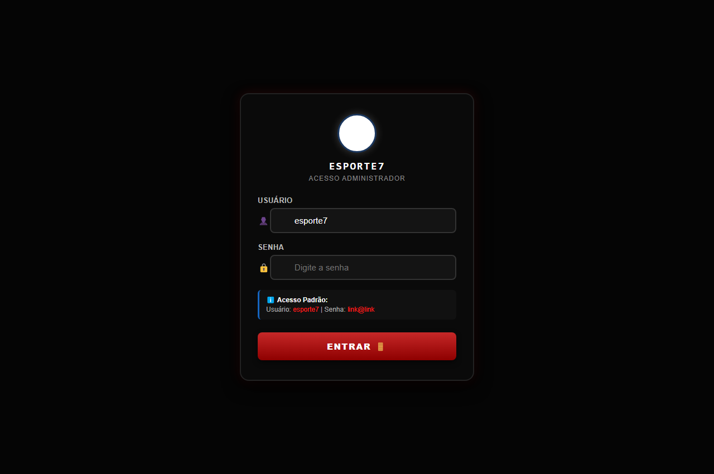
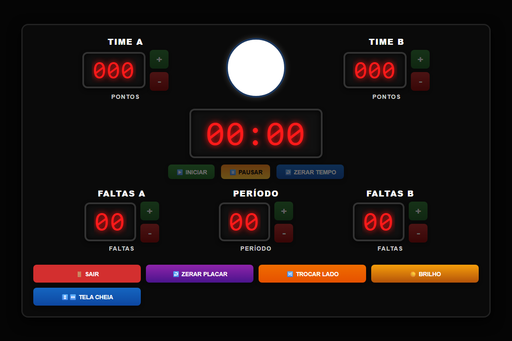
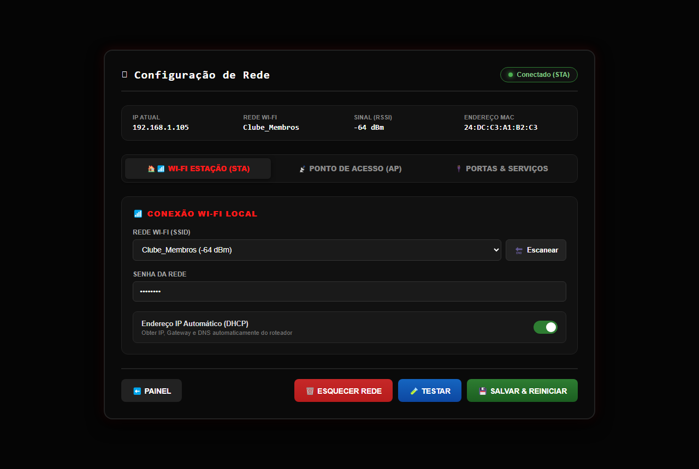
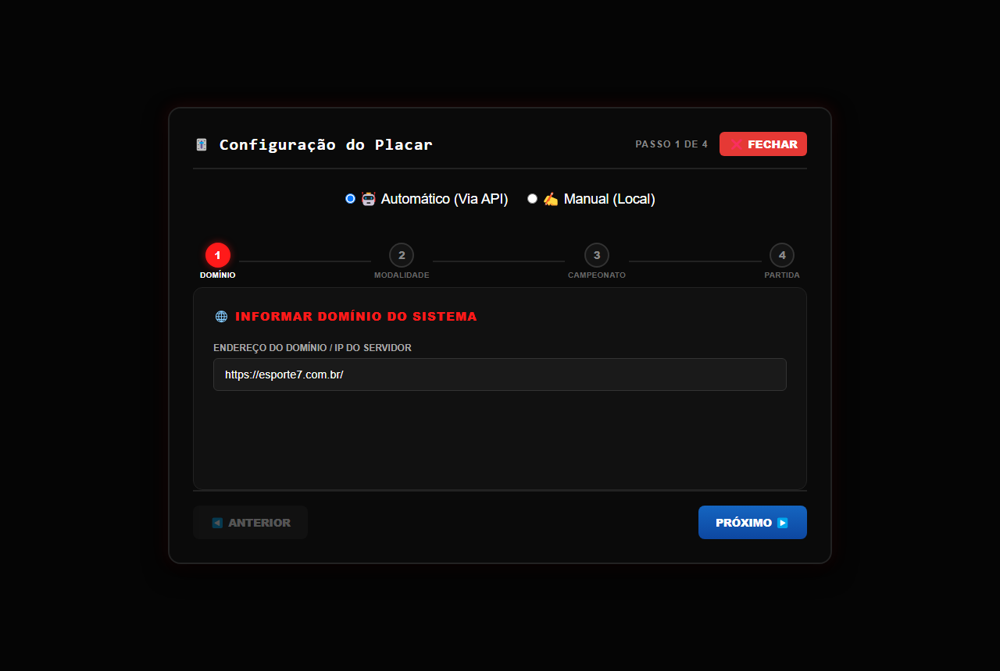
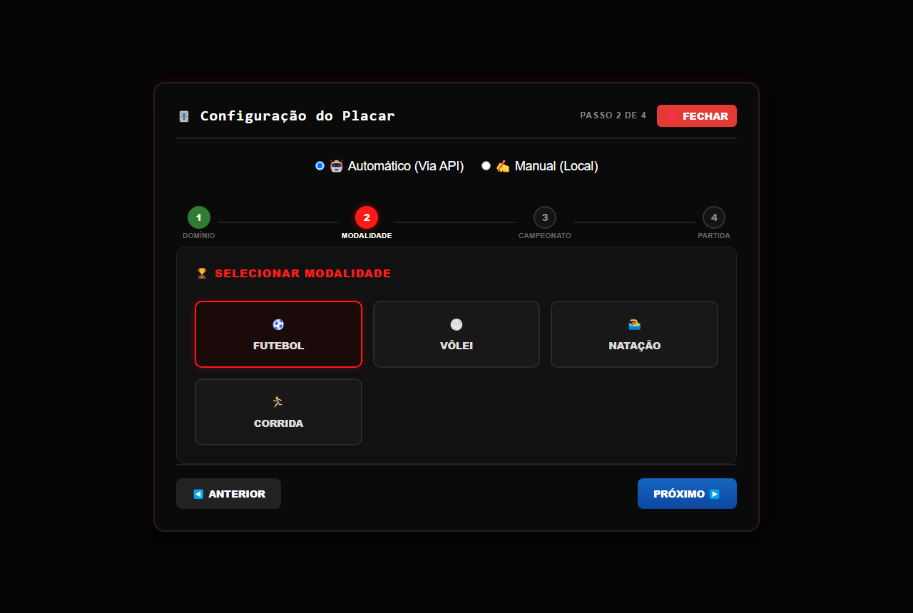
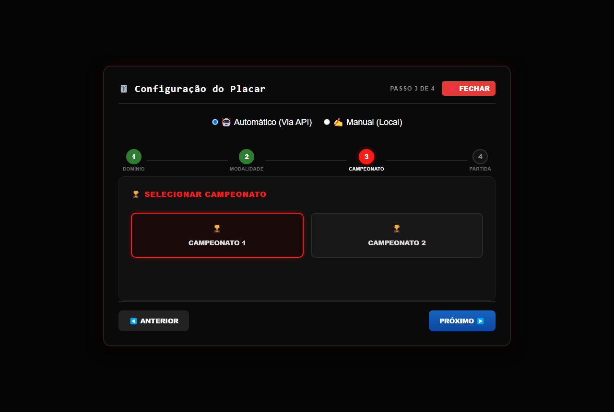
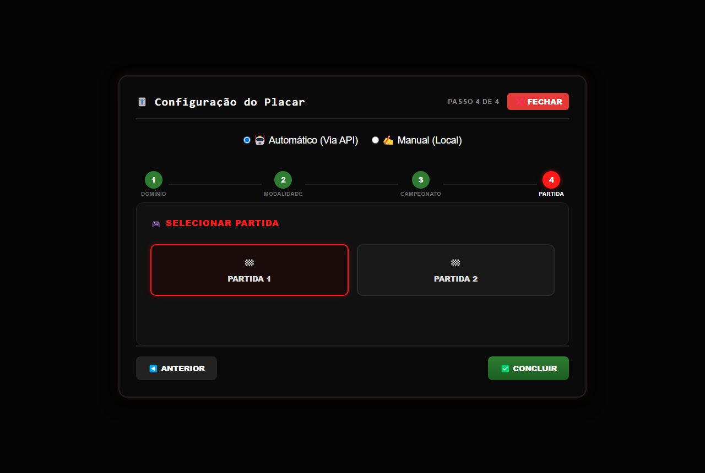
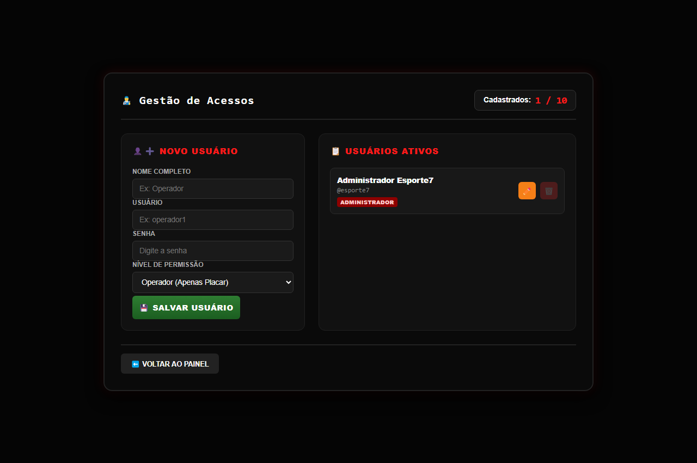
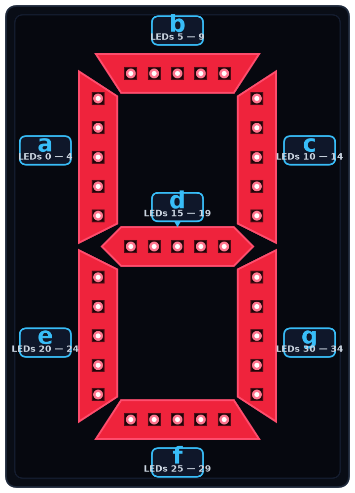

# 📖 Manual Ilustrado do Usuário — Placar Eletrônico ESP32-S3

Este guia apresenta todas as telas do sistema web embarcado do placar esportivo, explicando detalhadamente como operar cada funcionalidade através de capturas de tela passo a passo.

---

## 1. Primeiro Acesso e Conexão

Ao ligar o ESP32-S3 pela primeira vez ou após um reset de fábrica, ele inicializa seu próprio ponto de acesso Wi-Fi (Modo AP).

> **Dados de Conexão Padrão:**
> - **Rede Wi-Fi (SSID):** `esporte7system`
> - **Senha:** `Esporte7@`
> - **Endereço no Navegador:** `http://192.168.4.1` ou `http://placar.local`

---

## 2. Tela de Autenticação (Login)

Ao acessar o sistema, você será recepcionado pela tela de login:

### Instruções de Acesso:
1. Digite seu **Usuário** e **Senha**.
   - **Administrador padrão:** `esporte7`
   - **Senha padrão:** `link@link`
2. Clique no botão vermelho **ENTRAR**.

> O sistema possui suporte a múltiplos usuários com diferentes níveis de acesso (**Administrador** e **Operador**).

---

## 3. Painel Principal de Operação (`painel.html`)

A tela principal permite controlar todas as funções do placar em tempo real:

### Elementos do Painel:

* **Modo de Operação (Topo):**
  - **Automático API:** Recebe pontuações e cronômetro diretamente do servidor de campeonatos.
  - **Manual Local:** Permite controle total através dos botões da interface.

* **Pontuação (Time A e Time B):**
  - Clique no botão verde **`+`** para somar um ponto.
  - Clique no botão vermelho **`-`** para subtrair um ponto.
  - O placar suporta até 3 dígitos (0 a 999).

* **Controle de Faltas e Período:**
  - **Faltas A e Faltas B:** Incremento/decremento de faltas cometidas.
  - **Período:** Indicador do tempo/quarto de jogo atual (1º, 2º, etc.).

* **Cronômetro Central (MM:SS — 00 a 99 minutos):**
  - Exibe o tempo no formato **MM:SS** (00:00 a 99:59). Após completar 99 minutos, o próximo dígito de minuto cicla automaticamente para **00**.
  - **▶ INICIAR:** Dispara a contagem do tempo.
  - **⏸ PAUSAR:** Congela o tempo instantaneamente.
  - **↩ ZERAR TEMPO:** Reinicia o cronômetro para 00:00.

* **Barra de Ações Inferior:**
  - **ZERAR PLACAR:** Reseta pontos, faltas e períodos para zero.
  - **🔀 TROCAR LADO:** Inverte imediatamente a pontuação e faltas do Time A com o Time B (ideal para intervalos de jogo).
  - **⚙ CONFIGURAÇÕES:** Abre o assistente de parametrização e campeonatos.
  - **⛶ TELA CHEIA:** Expande a visualização para uso em tablets e TVs.
  - **SAIR:** Encerra a sessão atual com segurança.

---

## 4. Configuração de Rede Wi-Fi (`lan_config.html`)

Permite conectar o placar à rede Wi-Fi da quadra, clube ou ginásio, dispensando a necessidade de ficar conectado ao ponto de acesso do ESP32.

### Passo a Passo:
1. No cabeçalho da página, verifique o status da conexão, sinal RSSI e endereço MAC.
2. Na aba **Wi-Fi Estação (STA)**:
   - Clique em **Escanear** para listar as redes sem fio disponíveis no local.
   - Selecione a sua rede e informe a **Senha**.
   - Defina se deseja **DHCP (Automático)** ou atribua um **IP Estático**.
3. Clique em **SALVAR & REINICIAR**.
4. Após reiniciar, o placar estará disponível no IP da rede local ou pelo endereço `http://placar.local`.

---

## 5. Assistente de Configuração do Placar e Campeonatos (`panel_config.html`)

O assistente em 4 etapas permite vincular o placar à API de gerenciamento esportivo:

### Passo 1: Informar Domínio do Sistema

* Informe o endereço do servidor/API (ex: `https://esporte7.com.br/`).
* Clique em **PRÓXIMO ▶**.

### Passo 2: Selecionar a Modalidade

* Escolha a modalidade esportiva desejada (**Futebol**, **Vôlei**, **Natação**, **Corrida**, etc.).
* O sistema filtrará automaticamente os campeonatos correspondentes.

### Passo 3: Selecionar o Campeonato

* Selecione o campeonato em andamento na lista obtida da API.

### Passo 4: Selecionar a Partida

* Escolha a partida que está sendo disputada no momento.
* Clique em **✔ CONCLUIR** para sincronizar os dados do jogo em tempo real.

---

## 6. Gestão de Usuários e Permissões (`user_adm.html`)

Exclusivo para Administradores cadastrarem operadores e controlarem os acessos:

### Recursos:
* **Capacidade:** Suporta até **10 usuários cadastrados** na memória Flash (NVS).
* **Novo Usuário:**
  - Nome Completo
  - Nome de Usuário (login)
  - Senha
  - Nível de Permissão:
    - **Administrador:** Acesso total a todas as configurações de rede, usuários e placar.
    - **Operador:** Acesso restrito apenas ao painel de controle dos pontos da partida.
* **Usuários Ativos:** Lista os usuários cadastrados com opções de edição e exclusão.

---

## 7. Mapeamento Físico de Hardware dos LEDs

Cada dígito é formado por módulos de fita NeoPixel WS2812B (5 LEDs por segmento):

### Tabela Atualizada de Pinos (GPIO do ESP32-S3):

| Seção | Dígito | Posição | Pino GPIO |
| :--- | :---: | :---: | :---: |
| **Pontos Time A** | 0, 1, 2 | Centena, Dezena, Unidade | **GPIO 4, 5, 6** |
| **Pontos Time B** | 3, 4, 5 | Centena, Dezena, Unidade | **GPIO 1, 2, 3** |
| **Faltas Time A** | 6, 7 | Dezena, Unidade | **GPIO 7, 8** |
| **Período** | 8, 9 | Dezena, Unidade | **GPIO 9, 10** |
| **Faltas Time B** | 10, 11 | Dezena, Unidade | **GPIO 11, 12** |
| **Cronômetro (Minutos)** | 12, 13 | Dezena, Unidade | **GPIO 13, 14** |
| **Separador (Dois Pontos)** | — | LEDs Fixos | **GPIO 15** |
| **Cronômetro (Segundos)** | 14, 15 | Dezena, Unidade | **GPIO 16, 17** |
| **Cronômetro (Horas)** | 16, 17 | Dezena, Unidade | **GPIO 20, 21** |
| **Reset Físico (NVS)** | Botão | Pressionar por 5 segundos | **GPIO 0 (BOOT)** |
